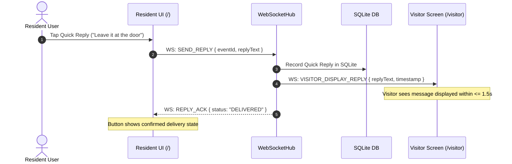

# SignalDoor — Architecture & Technical Design (ARCHITECTURE.md)

## 1. Executive Summary & Tech Stack (Option A: Unified TypeScript)

SignalDoor is architected as a unified TypeScript full-stack system optimized for low-latency visual alerts, WCAG 2.1 AA accessibility, and multimodal Amazon Bedrock processing. 

### Technology Stack
- **Runtime & Language:** Node.js (v22+, strictly requiring >=22 for built-in `node:sqlite` DatabaseSync) with TypeScript 5+.
- **Backend Framework:** Express.js with native WebSockets (`ws`).
- **AI Engine:** Amazon Bedrock Converse API via `@aws-sdk/client-bedrock-runtime` using the current small fast multimodal model available in region.
- **Ring Ingestion:** Unified `RingAdapter` interface with two swappable implementations selected via `RING_MODE=live|emulator`:
  - `RingApiAdapter` (Live): `POST /webhooks/ring` with HMAC signature verification, OAuth account linking (planned, not implemented), and `api.amazonvision.com` REST client.
  - `SimulatorAdapter` (Emulator): Generates identical webhook payload structures (built-in simulator (optional external ring-sandbox emulator not run)) through the same webhook path.
- **Persistence:** Local SQLite (`node:sqlite` `DatabaseSync` built into Node.js 22+) for logging visitor events, AI descriptions, and quick replies.
- **Frontend Framework:** React 18+ with Vite and Vanilla CSS design tokens (high contrast, large typography, zero heavy CSS framework bloat).
- **Communication:** Bidirectional WebSocket channel connecting Resident (`/`) and Visitor (`/visitor`) views.
- **Orchestration / Dev Boot:** Single root `npm run dev` running backend and client concurrently.

---

## 2. System Architecture & Components

```
+-------------------------------------------------------------------------------------------------+
|                                           SIGNALDOOR                                            |
|                                                                                                 |
|   [External Ring / Emulator]                                                                    |
|              |                                                                                  |
|              | HTTPS POST (HMAC-SHA256 signature)                                               |
|              v                                                                                  |
|   +-----------------------------------------------------------------------------------------+   |
|   | Public Tunnel Ingress (ngrok/localtunnel) - STRICTLY RESTRICTED                         |   |
|   | ONLY exposes: /webhooks/ring (OAuth /ring/link, /oauth/token planned, not implemented)   |   |
|   +--------------------------------------------+--------------------------------------------+   |
|                                                |                                                |
|                                                v                                                |
|                                    +-----------------------+                                    |
|                                    |  POST /webhooks/ring  |                                    |
|                                    |  (HMAC Verification)  |                                    |
|                                    +-----------+-----------+                                    |
|                                                | Verified Webhook Payload                       |
|                                                v                                                |
|                                    +-----------------------+                                    |
|                                    |      RingAdapter      |                                    |
|                                    |  (Live or Emulator)   |                                    |
|                                    +-----------+-----------+                                    |
|                                                | Normalized VisitorEvent                        |
|                                                v                                                |
|                                    +-----------------------+      +--------------------+        |
|                                    |    EventController    +----->|  SQLite Database   |        |
|                                    +-----+-----------+-----+      |  (Audit Log)       |        |
|                                          |           |            +--------------------+        |
|              +---------------------------+           +---------------------------+              |
|              | [Immediate Phase 1]                               | [Async Multimodal Call]      |
|              v                                                   v                              |
|   +---------------------+                             +--------------------+                    |
|   |    WebSocketHub     |                             |   BedrockService   |                    |
|   |  (Local/Protected)  |                             |   (Converse API)   |                    |
|   +----+-----------+----+                             +----------+---------+                    |
|        |           |                                             | [Phase 2 Enrichment <= 5s]   |
|        |           +<--------------------------------------------+                              |
|        |                                                                                        |
|        | (Protected WebSocket / Local Bind)                                                     |
|        +-----------------------------------------------+                                        |
|        v                                               v                                        |
|   +----+--------------------------+               +----+--------------------------+             |
|   | Resident Web UI (/)           |               | Visitor Doorbell (/visitor)   |             |
|   | - Phase 1 Immediate (<2s)     |               | - Doorbell visual screen      |             |
|   | - Phase 2 AI Summary (<5s)    |               | - Real-time resident reply    |             |
|   | - WCAG AA Contrast / Text     |               +---------------+---------------+             |
|   | - Safe Flashing Controls      |                               ^                             |
|   | - One-Tap Quick Replies       +-------------------------------+                             |
|   +-------------------------------+  (Quick Reply via WebSocket)                                |
+-------------------------------------------------------------------------------------------------+
```

### Component Responsibilities

1. **`RingWebhookRoute` (`src/server/routes/ring-webhook.ts`) & `RingOAuthRoute` (`src/server/routes/ring-oauth.ts` — planned, not implemented)**
   - Receives incoming Ring webhooks on `POST /webhooks/ring`.
   - Validates webhook authenticity using HMAC-SHA256 signatures (`X-Signature` header) against configured secret.
   - OAuth token lifecycle (`GET /ring/link` for user authorization, `POST /oauth/token` for code exchange) is planned, not implemented.
   - **Zero Secret Leakage:** Never logs access/refresh tokens. Tokens are kept in-memory or in git-ignored `.env.local`.
2. **`RingAdapter` Interface & Implementations (`src/server/adapters/`)**
   - **`RingAdapter` Interface:** Contract requiring `initialize()`, `onVisitorEvent(cb)`, and `getMediaFrame(mediaId)`.
   - **`RingApiAdapter` (`ring-api-adapter.ts`):** Connects to `https://api.amazonvision.com` for device discovery and media clip retrieval; extracts an ephemeral single frame (via `ffmpeg` child process) or falls back to metadata-only summary.
   - **`SimulatorAdapter` (`ring-simulator-adapter.ts`):** Produces the exact same webhook payload format as Ring. Connects to `ring-sandbox` (pip package) if running, or generates simulated signed webhooks locally with curated sample images.
   - Selected seamlessly via `RING_MODE=live|emulator`. Downstream event processing is 100% agnostic to the mode.
3. **`BedrockService` (`src/server/services/bedrock.ts`)**
   - Dispatches multimodal Converse API request to Amazon Bedrock with snapshot image bytes + event metadata.
   - Enforces strict 5.0-second timeout with fallback logic (`"Someone is at your door"`).
   - Generates concise plain-language summary (&le; 25 words).
   - **Zero Persistence:** Visitor images/frames are ephemeral and discarded immediately after the Bedrock call completes.
4. **`WebSocketHub` (`src/server/services/ws-hub.ts`)**
   - Manages authenticated/local WebSocket clients for resident (`/`) and visitor (`/visitor`) views.
   - Broadcasts Phase 1 immediate alerts (< 2.0s), streams Phase 2 Bedrock summary enrichments (< 5.0s), and relays quick replies.
5. **`DatabaseService` (`src/server/db/index.ts`)**
   - Lightweight SQLite store logging events, AI latencies, and quick replies.
   - Supports `better-sqlite3` with graceful fallback to `node:sqlite` or `sqlite3` on Windows.
6. **Resident UI (`src/client/components/ResidentAlert.tsx`)**
   - Accessible visual alert meeting WCAG 2.1 AA (contrast &ge; 4.5:1, text &ge; 24px).
   - Safe strobe rate (&le; 3 flashes/sec, WCAG 2.3.1), auto-disabled by `prefers-reduced-motion`, with manual UI toggle.
7. **Visitor Screen (`src/client/components/VisitorScreen.tsx`)**
   - Simulated doorbell screen rendering resident's reply in real time (< 1.5s).

---

## 3. Data Flow & Sequence

### 3.1 Ingestion & Two-Phase Alert Sequence

```mermaid
sequenceDiagram
    autonumber
    actor External as Ring Cloud / Sandbox Emulator
    participant Tunnel as Public Tunnel (Strict Ingress)
    participant WH as POST /webhooks/ring
    participant RA as RingAdapter (Live | Emulator)
    participant EC as EventController
    participant DB as SQLite DB
    participant WS as WebSocketHub
    participant UI as Resident UI (/)
    participant BedrockSvc as BedrockService
    participant BedrockAPI as Amazon Bedrock (Converse API)

    External->>Tunnel: POST /webhooks/ring (Signed with HMAC)
    Tunnel->>WH: Forward Webhook Request
    Note over WH: Verify HMAC-SHA256 signature
    WH->>RA: Parse Webhook Payload
    RA->>EC: Emit normalized VisitorEvent (Metadata + Snapshot Frame)
    activate EC

    EC->>DB: Log Event (Status: PENDING)
    EC->>WS: Dispatch Phase 1 Alert
    WS->>UI: WS: ALERT_PHASE_1 ("Someone is at your door")
    Note over UI: Visual alert renders within <= 2.0s
    
    par Async AI Enrichment (Handled by BedrockService)
        EC->>BedrockSvc: generateSummary(VisitorEvent)
        activate BedrockSvc
        BedrockSvc->>BedrockAPI: Converse API (Image bytes + Metadata)
        alt Bedrock Responds <= 5.0s
            BedrockAPI-->>BedrockSvc: Plain Summary (<= 25 words)
            BedrockSvc-->>EC: AI Summary Result
            deactivate BedrockSvc
            EC->>DB: Update Event (AI Summary, Latency)
            EC->>WS: Dispatch Phase 2 Alert
            WS->>UI: WS: ALERT_PHASE_2 (Bedrock Summary)
            Note over UI: UI text dynamically updates to AI summary
        else Timeout (> 5.0s) or Error
            BedrockAPI--xBedrockSvc: Timeout / Error
            BedrockSvc-->>EC: Fallback Triggered
            deactivate BedrockSvc
            EC->>DB: Log Timeout (Retain Fallback)
            Note over UI: UI stays calmly on Phase 1 fallback text
        end
    end
    deactivate EC
    Note over EC,BedrockSvc: Ephemeral image frame cleared from memory
```

### 3.2 Two-Way Quick Reply Sequence



---

## 4. Security, Ingress & Windows Portability

### 4.1 Ingress Isolation & Tunnel Rules
When using a public tunnel (e.g. ngrok or localtunnel) to receive live Ring cloud webhooks:
- **Allowed Public Ingress Paths (Whitelisted):**
  - `POST /webhooks/ring` (HMAC verification required)
  - *(OAuth routes `GET /ring/link` and `POST /oauth/token` are planned, not implemented)*
- **Local-Only Protected Bindings:**
  - `POST /api/simulator/trigger` is bound to `127.0.0.1` only or protected by `INTERNAL_DEV_SECRET` header.
  - WebSocket `/ws` is protected against unauthorized external connections.
- **Credential Hygiene:**
  - Zero tokens or secrets in version control.
  - Ring access and refresh tokens are held in-memory or persisted only in `.env.local` (ignored in `.gitignore`).
  - No secret tokens printed to terminal logs or debug outputs.

### 4.2 Windows SQLite Portability
- Native C++ builds (`node-gyp`) can occasionally encounter build tool friction on Windows.
- Architecture adopts dynamic SQLite driver resolution:
  1. Default: `better-sqlite3`.
  2. Fallback: Node 22+ built-in `node:sqlite` module or `sqlite3` prebuilt binaries.
  3. Ensures `npm install` and `npm run dev` succeed cleanly on standard Windows environments.

### 4.3 Honest Mode Disclosure
- If testing or presenting without access to physical Ring hardware or approved Ring production developer credentials, `RING_MODE=emulator` must be explicitly disclosed in `README.md` and during the demo video.

---

## 5. Data Models & Schemas

### 5.1 Shared Types (`src/shared/types.ts`)

```typescript
export type RingMode = 'live' | 'emulator';
export type EventType = 'ring' | 'motion' | 'test';

export interface RingWebhookPayload {
  eventId: string;
  timestamp: string;
  eventType: EventType;
  deviceId: string;
  mediaUrl?: string; // Video clip URL in live mode or sample asset key in emulator
  signature?: string;
}

export interface VisitorEvent {
  id: string;
  timestamp: string;
  eventType: EventType;
  imageBuffer?: Buffer; // Ephemeral in-memory image frame (never saved to disk)
  metadata: {
    deviceId: string;
    locationName?: string;
    mediaUrl?: string;
  };
}

export type AlertPhase = 'PHASE_1_IMMEDIATE' | 'PHASE_2_ENRICHED';

export interface AlertPayload {
  eventId: string;
  phase: AlertPhase;
  timestamp: string;
  title: string;
  body: string; // "Someone is at your door" (Phase 1) or Bedrock summary (Phase 2)
  timeoutFallback: boolean;
}

export type QuickReplyText =
  | 'Leave it at the door'
  | 'Coming in 2 minutes'
  | "I can't hear, please text me";

export interface QuickReplyMessage {
  eventId: string;
  reply: QuickReplyText;
  timestamp: string;
}

export type WebSocketClientMessage =
  | { type: 'SUBSCRIBE'; role: 'resident' | 'visitor'; secret?: string }
  | { type: 'QUICK_REPLY'; payload: QuickReplyMessage };

export type WebSocketServerMessage =
  | { type: 'ALERT_PHASE_1'; payload: AlertPayload }
  | { type: 'ALERT_PHASE_2'; payload: AlertPayload }
  | { type: 'VISITOR_REPLY_DISPLAY'; payload: { reply: string; timestamp: string } }
  | { type: 'REPLY_ACK'; payload: { eventId: string; status: 'DELIVERED' } };
```

### 5.2 SQLite Schema

```sql
CREATE TABLE IF NOT EXISTS events (
  id TEXT PRIMARY KEY,
  timestamp DATETIME DEFAULT CURRENT_TIMESTAMP,
  event_type TEXT NOT NULL,
  fallback_text TEXT NOT NULL,
  ai_summary TEXT,
  ai_latency_ms INTEGER,
  status TEXT NOT NULL -- 'PENDING', 'ENRICHED', 'FALLBACK_TIMEOUT', 'FAILED'
);

CREATE TABLE IF NOT EXISTS replies (
  id INTEGER PRIMARY KEY AUTOINCREMENT,
  event_id TEXT NOT NULL,
  reply_text TEXT NOT NULL,
  sent_at DATETIME DEFAULT CURRENT_TIMESTAMP,
  FOREIGN KEY (event_id) REFERENCES events(id)
);
```

---

## 6. Folder Structure

```
amzon/
├── .agent/
├── .env.example
├── .gitignore
├── LICENSE (MIT)
├── package.json
├── tsconfig.json
├── tsconfig.node.json
├── vite.config.ts
├── public/
│   └── favicon.ico
├── src/
│   ├── shared/
│   │   └── types.ts                         # Shared contracts, enums, & schemas
│   ├── server/
│   │   ├── index.ts                         # App entry point (boots server & initializes RingAdapter)
│   │   ├── config.ts                        # Env parsing (RING_MODE, AWS region, secrets)
│   │   ├── controllers/
│   │   │   └── event-controller.ts          # Coordinates Phase 1 broadcast, Bedrock call, Phase 2 broadcast
│   │   ├── routes/
│   │   │   ├── ring-webhook.ts              # POST /webhooks/ring (HMAC signature verification)
│   │   │   ├── ring-oauth.ts                # GET /ring/link, POST /oauth/token (planned, not implemented)
│   │   │   └── api.ts                       # Local protected endpoints (/api/simulator/trigger, /api/health)
│   │   ├── adapters/
│   │   │   ├── ring-adapter.interface.ts    # RingAdapter common interface
│   │   │   ├── ring-api-adapter.ts          # Live adapter: api.amazonvision.com & media clip frame extract
│   │   │   └── ring-simulator-adapter.ts    # Emulator adapter: ring-sandbox or local signed webhook issuer
│   │   ├── services/
│   │   │   ├── bedrock.ts                   # Bedrock Converse API with 5s timeout & fallback
│   │   │   └── ws-hub.ts                    # WebSocket hub with connection filtering
│   │   ├── db/
│   │   │   └── index.ts                     # SQLite DB wrapper with fallback driver resolution
│   │   └── assets/
│   │       └── sample-visitors/             # Curated sample snapshot images for emulator mode
│   └── client/
│       ├── index.html
│       ├── main.tsx
│       ├── App.tsx
│       ├── styles/
│       │   └── index.css                    # WCAG AA design tokens, high contrast, safe animations
│       ├── hooks/
│       │   └── useDoorbellSocket.ts          # WebSocket client hook with reconnection
│       └── components/
│           ├── ResidentAlert.tsx            # Two-phase visual alert banner with safe strobe (<3/s)
│           ├── QuickReplies.tsx             # Accessible one-tap quick replies
│           ├── VisitorScreen.tsx            # Simulated doorbell camera screen
│           └── FlashToggle.tsx              # User toggle for visual flashing
└── tests/
    ├── ring-adapter.test.ts                 # Tests entry point imports & calls RingAdapter
    ├── ring-webhook-hmac.test.ts            # Validates HMAC signature verification on webhook
    ├── bedrock-service.test.ts              # Multimodal payload & 5s timeout fallback
    ├── accessibility.test.ts                # WCAG AA contrast, 24px typography, flash rate <= 3/s
    └── two-phase-alert.test.ts              # End-to-end webhook-to-UI two-phase alert flow
```

---

## 7. Open Questions & Technical Contingencies

1. **Ring Live Clip Frame Extraction vs. Still Snapshot:**
   - *Status:* Open technical question. Ring API provides video clips (`.mp4`) rather than confirmed still snapshots.
   - *Plan:* In live mode, extract a single frame via lightweight ffmpeg or fall back to metadata-only summarization if media processing is delayed. In emulator mode, use local sample snapshot images. Ephemeral images are wiped immediately after Bedrock returns.
2. **Day 2 Fallback Trigger:**
   - If simulated or live Ring events cannot be received end-to-end through the webhook path by the end of Day 2, trigger fallback to an Alexa+ MCP server (Streamable HTTP) implementing the identical visual alert and Bedrock architecture.
3. **Bedrock Region Model Quota:**
   - Verify small fast multimodal model access is activated in the selected AWS region (e.g. `ap-southeast-2` with Amazon Nova Lite, configurable via `AWS_REGION` and `BEDROCK_MODEL_ID`).
